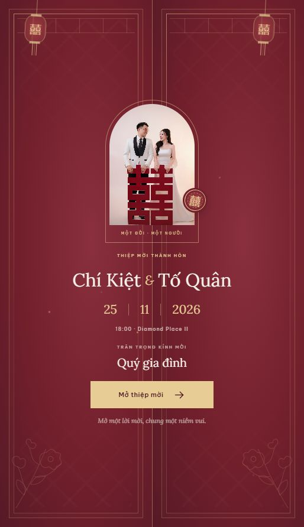
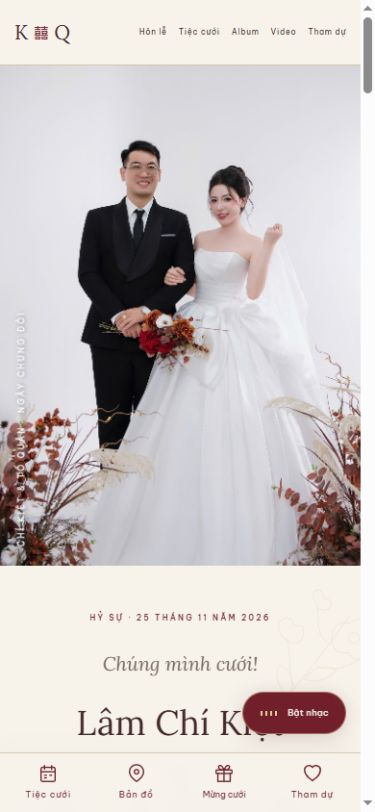

# Thiệp cưới Chí Kiệt & Tố Quân

Thiệp HTML, CSS, JavaScript thuần, phong cách Trung Hoa với đỏ son, vàng champagne, đèn lồng và chữ song hỷ. Tiêu đề dùng **Lora**, nội dung dùng Be Vietnam Pro. Không cần npm hoặc bước build. Máy chủ local cho RSVP dùng Python 3.10 trở lên, không cần cài thêm thư viện.

## Xuất bản lên GitHub Pages

Cấu trúc dành cho triển khai:

```text
.github/workflows/pages.yml  # Tự triển khai khi public/ thay đổi trên main
public/                     # Toàn bộ website tĩnh, không cần build
  index.html
  config.js                 # Tên khách, QR, URL biểu mẫu RSVP
  guest-map.js
  guests.html               # Công cụ tạo link, tải danh sách để commit
  assets/                   # Ảnh, nhạc, video và lịch
server.py                   # Chỉ dùng local để lưu RSVP
start-local.cmd
docs/                       # Ảnh xem trước, không đưa lên Pages
```

1. Trong repo, mở **Settings → Pages → Build and deployment → Source**, chọn **GitHub Actions**.
2. Mở **Actions → Deploy wedding invitation to GitHub Pages → Run workflow**, chọn `main`. Những lần push thay đổi `public/` về sau sẽ tự triển khai.
3. Đợi workflow hoàn thành. URL dự kiến: **https://chikiet-daubep.github.io/wedding-invitations/**. URL chính xác hiện trong kết quả deployment.
4. Thử link cá nhân hóa: **https://chikiet-daubep.github.io/wedding-invitations/?guest=gia-dinh**.

Workflow chỉ upload `public/`, dùng các action chính thức theo [hướng dẫn GitHub](https://docs.github.com/en/pages/getting-started-with-github-pages/using-custom-workflows-with-github-pages). Đường dẫn tài nguyên là tương đối nên hoạt động dưới `/wedding-invitations/` và khi dùng tên miền riêng. `.nojekyll` giữ nguyên tệp tĩnh. Không cần npm, token thủ công hoặc tệp build.

### RSVP trên GitHub Pages

GitHub Pages không chạy Python hoặc SQLite. Bản online ẩn biểu mẫu local và sổ lời chúc để khách không bấm gửi vào API không tồn tại. Để nhận xác nhận online, tạo Google Form rồi điền URL HTTPS trong `public/config.js`:

```js
rsvpFormUrl: 'https://docs.google.com/forms/d/e/MA_FORM/viewform',
```

Khi có URL hợp lệ, phần tham dự hiện nút mở biểu mẫu. Google Form nhận phản hồi riêng; lời chúc không tự đồng bộ lên thiệp. Để trống thì phần này chỉ hiện lời hẹn gặp. Bản local chạy `start-local.cmd` vẫn giữ đầy đủ RSVP và sổ lời chúc SQLite như trước.

### Cập nhật khách mời khi online

Mở `/wedding-invitations/guests.html`, tạo danh sách, tải `guest-map.js`, thay `public/guest-map.js` và commit/push. Sau deployment, thử tên khách rồi mới gửi link. Công cụ trên Pages không ghi được vào repo. Có thể chỉnh trực tiếp `public/config.js` hoặc `public/guest-map.js`.

## Mở thiệp

Để dùng **đầy đủ cả RSVP và sổ lời chúc**, chạy `start-local.cmd` rồi mở `http://127.0.0.1:4173/` bằng Chrome, Edge, Safari hoặc Firefox hiện đại. Giữ cửa sổ máy chủ mở trong lúc sử dụng; nhấn Ctrl+C để dừng. Nếu cần đổi cổng: `python server.py --port 4174`.

Các tệp ảnh, nhạc và video đã đi kèm. Có thể mở `public/index.html` trực tiếp để xem phần thiệp. Khi mở như vậy hoặc đưa `public/` lên GitHub Pages, biểu mẫu RSVP local và sổ lời chúc được ẩn. Có thể đặt link Google Form trong `rsvpFormUrl` để khách xác nhận tham dự online. Muốn nhận RSVP từ khách bên ngoài, cần máy chủ được triển khai riêng; máy chủ Python đi kèm chỉ phục vụ bản local.

Font Google và bản đồ cần Internet; khi mất kết nối, chữ dùng font dự phòng. Bản đồ không cần khóa API; có nút chỉ đường riêng nếu iframe không hiển thị.

## Cá nhân hóa người nhận qua URL

Sửa `public/config.js`, mục `guests`:

```js
guests: {
  'gia-dinh': 'Quý gia đình',
  'ban-be': 'Bạn và người thương',
  'anh-minh': 'Anh Nguyễn Văn Minh', // Tên ví dụ, hãy thay bằng khách thật.
},
```

Gửi link dạng `https://ten-mien-cua-ban/?guest=anh-minh`. Alias `?to=anh-minh` cũng được hỗ trợ. Mã không có trong danh sách hiển thị `Quý khách`. Mã được chuyển thành chữ thường; nên dùng chữ không dấu và dấu gạch nối. Tên khách được chèn bằng `textContent`, không xử lý như HTML.

Hoặc mở `http://127.0.0.1:4173/guests.html` để dùng **công cụ tạo link khách mời**. Mỗi dòng nhập một tên, hoặc `ma-khach | Tên đầy đủ`. Bấm **Tạo & lưu danh sách**: bản local ghi thật vào `public/guest-map.js` và `public/guest-map.json`; link mới lập tức hiện đúng tên. Danh sách này ưu tiên hơn `config.js` nếu trùng mã. Khi dùng hosting tĩnh, tải `guest-map.js` rồi thay vào cùng thư mục với `index.html`.

Các link bắt đầu bằng `127.0.0.1` chỉ dùng xem trên máy đang chạy thiệp. Khi có hosting thật, đổi ô **Đường dẫn gốc của thiệp** thành URL hosting trước khi sao chép link gửi khách.

Nếu mở trực tiếp trên máy, thêm `?guest=gia-dinh` vào cuối URL của `index.html`. Toàn bộ danh sách trong JavaScript có thể được người xem đọc; chỉ lưu tên hiển thị và mã khách, không thêm dữ liệu riêng tư khác.

## Thay QR mừng cưới

QR hiện tại dùng SVG đỏ son tại `public/assets/qr-mung-cuoi.svg`, được vẽ lại từ dữ liệu QR TPBank gốc do gia đình cung cấp (giữ nguyên payload và kiểm tra CRC, giải mã đối chiếu); chủ tài khoản GIANG CHI KIET, số tài khoản 00000272054. Chép ảnh QR thật vào `public/assets/qr-ngan-hang.png`, sau đó sửa:

```js
gift: {
  qrImage: 'assets/qr-ngan-hang.png',
  isMock: false,
  bank: 'Tên ngân hàng',
  accountNumber: 'Số tài khoản',
  accountName: 'Tên chủ tài khoản',
},
```

Khi `isMock: true`, thiệp ghi rõ “QR mẫu · Chưa dùng để chuyển khoản” và ẩn thông tin ngân hàng. Khi đổi thành `false`, thiệp hiện thông tin đã nhập và nút sao chép số tài khoản. Hãy quét thử QR để kiểm tra đúng người nhận trước khi gửi thiệp.

## Ảnh, video và nhạc

- Chín ảnh cưới gốc nằm trong `public/assets/photo-01.jpg` đến `photo-09.jpg`, theo thứ tự tên tệp nguồn tăng dần; mọi ảnh đều có trong album.
- Nhạc nền dùng đúng `Violin.mp3` bạn cung cấp, bắt đầu sau thao tác mở thiệp. Nút nhạc ở góc dưới cho phép bật/tắt.
- Video slideshow đã được tối ưu từ tệp 4K xuống 720p để tải qua mạng thuận tiện hơn. Video chỉ tải khi người xem bấm phát; có nút điều khiển và hỗ trợ toàn màn hình của trình duyệt.
- Khi video phát, nhạc nền tạm dừng; khi video dừng/kết thúc, nhạc tiếp tục nếu người xem vẫn bật nhạc.
- Thay đường dẫn nhạc/video ở `config.js` nếu muốn dùng tệp khác.

## Ngày và giờ

Đồng hồ đếm tới **18:00 ngày 25/11/2026, múi giờ Việt Nam (+07:00)**. Sau mốc này, đồng hồ về 0 và hiện lời cảm ơn. Hôn lễ tại tư gia lúc 06:00 được trình bày riêng. Ngày âm lịch được giữ theo thông tin bạn cung cấp: 17/10 năm Bính Ngọ.

Tệp `assets/tiec-cuoi.ics` cho phép thêm tiệc vào lịch, bắt đầu 18:00. Thời lượng lịch tạm đặt 3 giờ để tiện giữ lịch; đây không phải thời gian kết thúc đã được gia đình xác nhận. Có thể sửa `DTEND` nếu cần.

## Những phần đã có

Mở cửa 3D, dấu song hỷ, đèn lồng, hạt sáng; ảnh lớn zoom chậm và chuyển động nhẹ theo cuộn; giảm chuyển động theo cài đặt của thiết bị; giao diện điện thoại/máy tính; thanh tiện ích mobile; đầy đủ thông tin hai gia đình; hôn lễ; tiệc; đồng hồ; album phóng to, vuốt và phím mũi tên; video; nhạc; bản đồ; thêm lịch; hộp QR; xem lại bìa; công cụ tạo link; RSVP và sổ lời chúc.

## Xác nhận tham dự và sổ lời chúc

Phản hồi lưu trong `data/wedding.sqlite3` trên máy, vẫn còn sau khi dừng/chạy lại máy chủ. Tên, tình trạng tham dự, số người và lời chúc được lưu. Khách phải tự chọn **Cho phép hiện tên và lời chúc** thì nội dung mới xuất hiện trên sổ; bỏ chọn rồi cập nhật sẽ ẩn lời chúc đó. Số người chỉ được tính khi chọn sẽ tham dự.

Trình duyệt lưu một mã phản hồi để lần cập nhật thay thế phản hồi trước, tránh tạo trùng khi gửi lại. Cùng thiết bị và cùng mã khách sẽ chỉnh cùng phản hồi; nếu nhiều người dùng chung máy, dùng link có mã khách riêng cho từng người.

Trang `guests.html` có phần xem phản hồi, tổng số người xác nhận và tải CSV (mở được bằng Excel). Máy chủ chỉ lắng nghe `127.0.0.1`; các API quản lý chỉ dùng trong bản local. Dữ liệu riêng không được đưa vào gói ZIP giao ban đầu. Khi sao lưu về sau, giữ thêm thư mục `data/` và hai tệp `guest-map.*` đã chỉnh.

Máy chủ đi kèm là máy chủ xem thử local, không phải cấu hình triển khai Internet. Việc triển khai công khai sau này cần xác thực cho trang quản lý, chống spam, sao lưu và cấu hình HTTPS. Thiệp hiện không tự gửi email/tin nhắn.

## Hình xem trước





## Các tệp trong repo

- `public/`: toàn bộ HTML, CSS, JavaScript và tài nguyên để chạy thiệp.
- `public/assets/`: chín ảnh cưới, Violin MP3, slideshow MP4 đã tối ưu, QR TPBank, biểu tượng, ảnh bìa video và lịch ICS.
- `server.py`, `start-local.cmd`: máy chủ và tệp khởi chạy local có lưu RSVP.
- `docs/`: hình xem trước bìa và giao diện mobile.

Repo không chứa cơ sở dữ liệu phản hồi thật của khách, tệp kiểm thử, thông tin đăng nhập hoặc mã định danh của dịch vụ hosting. Workflow GitHub Pages chỉ xuất bản thư mục public/, không xuất bản máy chủ Python hoặc dữ liệu RSVP.

## Giao diện hiện tại

Section xác nhận tham dự đã được bỏ khỏi thiệp theo yêu cầu. Câu “MỘT LỜI HẸN, MỘT NIỀM VUI” được giữ ở footer. Các phần hướng dẫn RSVP ở trên mô tả tính năng trước đây; máy chủ và công cụ quản lý vẫn giữ dữ liệu phản hồi cũ, nhưng thiệp không còn biểu mẫu gửi RSVP hoặc nút Google Form.
